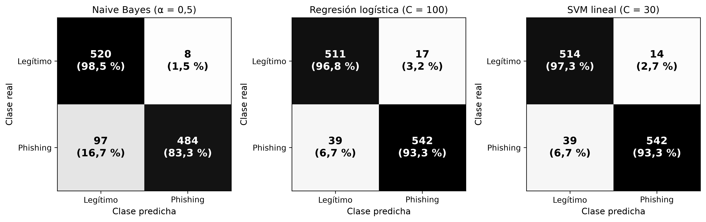
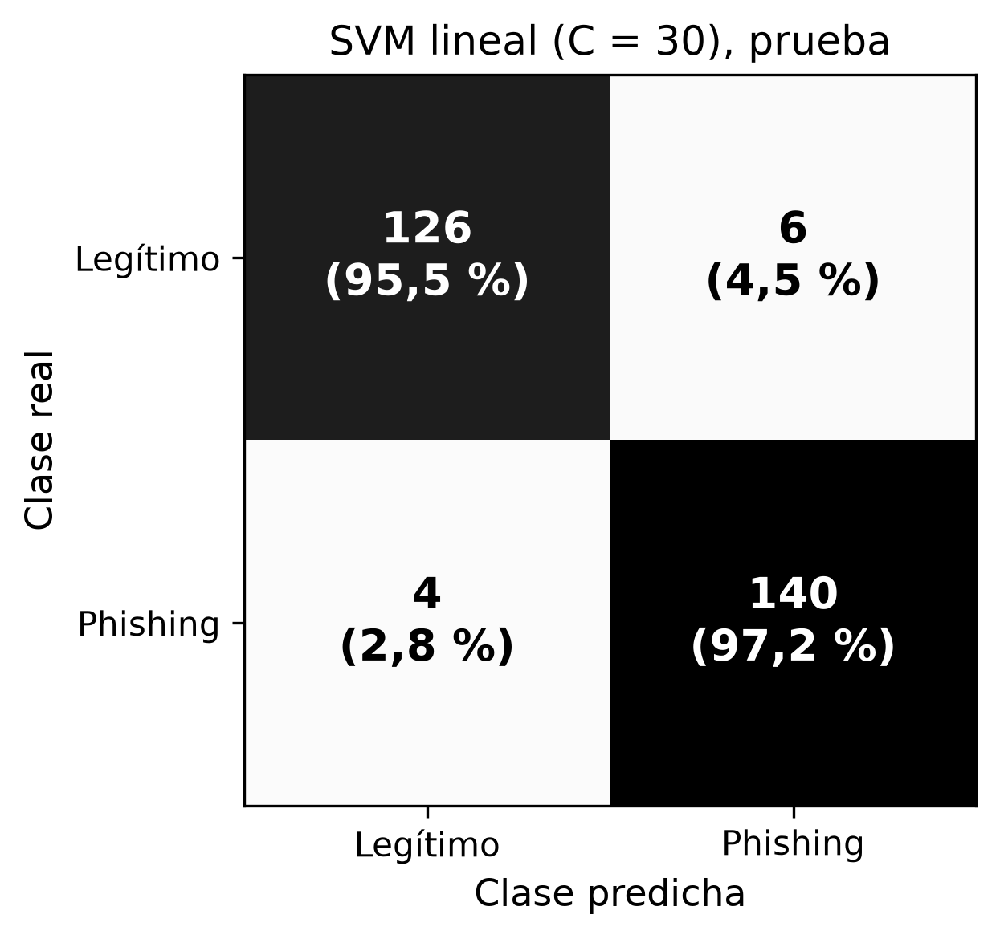
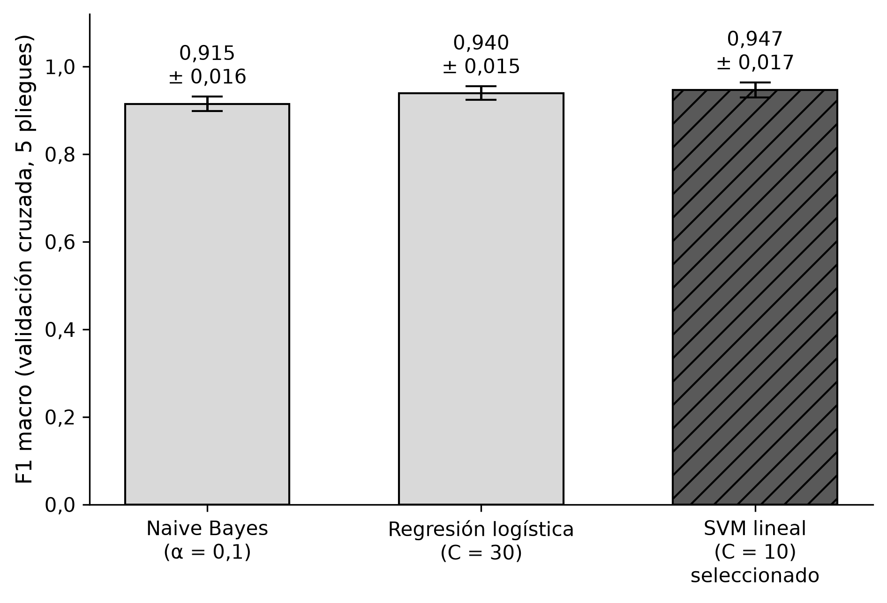

# Métricas de SICAE-IA

## Dataset

El modelo phishing vs. legítimo se entrena solo con **SpaPhish**, un corpus de correos en español.

| Dato | Valor |
|---|---|
| Fuente | [Mendeley Data — SpaPhish](https://data.mendeley.com/datasets/hz2d6gz7pc/5) |
| Licencia | CC BY 4.0 |
| Idioma | Español |
| Correos originales | 1.395 (731 phishing, 664 legítimos) |
| Quitados por no tener asunto | 3 |
| Quitados por cuerpo de menos de 30 caracteres | 7 |
| **Correos finales** | **1.385 (725 phishing, 660 legítimos)** |

La carga, verificación y depuración están en [`ml/sicae_ml/load_data.py`](../ml/sicae_ml/load_data.py).
Para reproducirlas, ver *Cómo obtener los datos* en el [README](../README.md#cómo-obtener-los-datos).

### Por qué se descartó SpearPhishMX

SpearPhishMX se evaluó como segundo dataset y se descartó por tres razones. Primero, su etiqueta 0
significa "no dirigido" y no "legítimo", así que no encaja con nuestra clasificación phishing vs.
legítimo. Segundo, comparte el 42 % de los asuntos con SpaPhish, pero con etiquetas contradictorias,
lo que le enseñaría al modelo respuestas opuestas para el mismo correo. Tercero, su anonimización
deja marcadores en el texto que el modelo aprendería como señal, en lugar de aprender del contenido
real del correo.

> *Nota: Cifras obtenidas comparando ambos CSV: asuntos normalizados en común (1.276 de 3.006) y
> tabla cruzada de etiquetas entre los mensajes coincidentes. El análisis se puede repetir con un
> script si el jurado lo solicita.*

## Exploración (paso 1.2)

Cifras obtenidas con [`ml/notebooks/01_exploracion.ipynb`](../ml/notebooks/01_exploracion.ipynb)
sobre los 1.385 correos finales. Las gráficas están en [`ml/reports/`](../ml/reports/).

| Medida | Legítimo | Phishing |
|---|---|---|
| Correos | 660 (47,7 %) | 725 (52,3 %) |
| Longitud del cuerpo, promedio (caracteres) | 1.769 | 697 |
| Longitud del cuerpo, mediana (caracteres) | 1.115 | 539 |
| Enlaces (`n_urls`), promedio | 8,47 | 4,95 |
| Enlaces (`n_urls`), mediana | 3 | 4 |
| Correos con al menos un enlace | 74,9 % | 96,3 % |
| Adjuntos (`n_adjuntos`), promedio | 0,72 | 0,03 |
| Correos con al menos un adjunto | 37,6 % | 2,8 % |

- **Clases balanceadas:** no hace falta rebalancear; basta con dividir de forma estratificada.
- **El phishing es más corto:** la longitud del cuerpo puede servir como señal.
- **Enlaces y adjuntos:** casi todo el phishing trae al menos un enlace, pero los legítimos traen
  más enlaces en promedio y casi todos los adjuntos. Son señales útiles, pero no sirve la regla
  simple "muchos enlaces = phishing".
- **Palabras más frecuentes** (asunto + cuerpo, sin URLs ni palabras vacías en español):
  - Phishing: paquete, entrega, suscripción, recibir, cuenta, icloud, pago, información, correo,
    clic. Urgencia y suplantación de marcas.
  - Legítimo: correo, información, datos, electrónico, cuenta, saludos, privacidad, personales,
    aviso, gracias. Trámites, instituciones y avisos de privacidad.

### Hallazgos para el preprocesamiento

1. **Nombres que el modelo aprendería como atajo.** "pablito" aparece en 169 correos de phishing
   (asunto o cuerpo) y en ninguno legítimo: es el nombre del destinatario, no una señal de phishing.
   Pasa algo parecido del lado legítimo con "puebla" y "ricardo".
2. **Campañas repetidas.** 210 asuntos de phishing están repetidos (misma plantilla). Si copias
   de una campaña quedan en entrenamiento y en prueba, la evaluación saldrá inflada: conviene
   agrupar por asunto al dividir.
3. **El phishing imita a la publicidad.** "darse de baja" aparece en el cuerpo de 187 correos de
   phishing y de 7 legítimos. La regla de publicidad debe apoyarse en la cabecera
   `List-Unsubscribe` y no solo en el texto.
4. **Texto en inglés.** "the" está entre las 20 palabras más frecuentes de ambas clases y "and"
   entre las de legítimo; la lista de palabras vacías en español no las filtra.

## Preprocesamiento (paso 1.3)

[`ml/sicae_ml/preprocess.py`](../ml/sicae_ml/preprocess.py) lee `correos.csv` y guarda
`ml/data/processed/correos_limpios.csv` con las columnas `texto` (asunto + cuerpo limpios con
`limpiar_texto()` de [`ml/sicae_ml/texto.py`](../ml/sicae_ml/texto.py)), `n_urls`, `n_adjuntos`,
`long_cuerpo` (del cuerpo original), `etiqueta` y `grupo`. La columna `date` no se usa.

### Qué se reemplazó o borró y por qué

Conteo de una ejecución sobre los 1.385 correos. Los nombres, lugares y organizaciones se buscan
como palabra completa: "salas" se cambia, pero "ensaladas" no.

**Regla:** un dato anonimizado se cambia por un token solo si el token queda en las dos clases.
Si quedaría en una sola, se borra, porque un token exclusivo de una clase sigue siendo un atajo.

| Qué | Acción | Veces | Por qué |
|---|---|---|---|
| Etiquetas y comentarios HTML (`<p>`, `<td>`, `<!-- -->`…) y entidades (`&aacute;`, `&nbsp;`) | se quitan | 842 etiquetas | Son formato, no contenido. Solo se quitan etiquetas HTML reales: `<<Cancelar>>` es el texto de un botón y se conserva |
| URLs (`http://`, `https://`, `www.`) | `urltoken` | 1.583 | Cada URL es casi única; importa que haya un enlace, no cuál |
| Correos electrónicos | `emailtoken` | 890 | Igual que las URLs; además se llevan nombres de personas |
| Nombres de la anonimización: pablito (172), ezequiela (84), miguelina (83), guadalupe (58), robles (54), missxtranger (52), salas (43), jiménez (42), garcía/garcia (41), vargas (39), pancracio (34), durán/duran (34), martínez/martinez (46) | `nombretoken` | 782 | Cada nombre estaba en una sola clase. El token queda en ambas: 333 correos de phishing y 184 legítimos |
| Direcciones ficticias de los pies de página ("escriba a: 128 Willow Crest Rd Ste 402#5912, Northwood, VT, 05744", "Or write to: …", "correo electrónico à: …", "escribiendo a …") | se borra la dirección; se conserva "escriba a:" | 149 | Solo aparecen en phishing (120 correos). Antes dejaban "ste" en 105 correos de phishing y 0 legítimos; ahora en 0 |
| Lugares: hidalgo (33), ciudad central (17) | se borran | 50 | Sin las direcciones, `lugartoken` quedaba en 35 legítimos y 0 de phishing. "northwood" solo estaba dentro de direcciones |
| Organizaciones (`ORGS_ANONIMIZADAS`): myown (127), cietec (81), estelar (81), sni (29) | se borran | 318 | Solo en legítimos: myown en 52 correos, cietec en 24, sni en 22 y estelar en 21, ninguna en phishing. Un `orgtoken` quedaría en una sola clase |
| Letras decoradas de Unicode ("𝐇𝐞𝐦𝐨𝐬", "𝑭𝑨𝑪𝑻𝑼𝑹𝑨𝑺") | se normalizan con NFKC ("hemos", "facturas") | 23 correos de phishing, 0 legítimos | Ver "Normalización Unicode (NFKC)" abajo |
| Mayúsculas y espacios repetidos | minúsculas, un espacio | — | "URGENTE" y "urgente" son la misma palabra |

### Qué se dejó y por qué

| Qué | Por qué |
|---|---|
| Marcas (FedEx, Apple, iCloud, Netflix, Prime, Estafeta…) | Son contenido real: el phishing suplanta marcas. Quitarlas borraría una señal legítima |
| La frase "escriba a" | Es texto real del pie de baja de suscripción. Se borra solo la dirección que la sigue |
| Números, signos y emojis en `texto` | Pueden ser señal ("!!", "📦", montos). Se deciden al vectorizar (paso 1.4) |
| Palabras vacías en español e inglés | `STOPWORDS_ES` y `STOPWORDS_EN` se aplican al vectorizar, no aquí, para que `texto` sea legible |
| `n_urls`, `n_adjuntos` y `long_cuerpo` | Señales medidas en la exploración. `long_cuerpo` usa el cuerpo original para no cambiar al limpiar |

### Normalización Unicode (NFKC)

Algunos correos de phishing escriben el asunto o el cuerpo con letras "decoradas" de Unicode
(negrita o cursiva matemática): "𝐇𝐞𝐦𝐨𝐬 𝐢𝐧𝐭𝐞𝐧𝐭𝐚𝐝𝐨 𝐩𝐨𝐧𝐞𝐫𝐧𝐨𝐬 𝐞𝐧 𝐜𝐨𝐧𝐭𝐚𝐜𝐭𝐨". A la vista se lee
normal, pero para la computadora son otros caracteres: es un truco para esquivar filtros.
Aparecen en 23 correos de phishing y en ninguno legítimo. Sin tratarlas causaban dos problemas:

1. **Grupos vacíos.** `normalizar_asunto` solo conserva letras normales, así que 7 asuntos de
   phishing quedaban sin ninguna letra; el CSV los guardaba como nulos y la división por grupos
   del paso 1.4 fallaba.
2. **Palabras duplicadas.** El TF-IDF trataría "𝐞𝐧" y "en" como palabras distintas.

`limpiar_texto()` aplica `unicodedata.normalize("NFKC", …)` justo después de decodificar el HTML:
"𝐇𝐞𝐦𝐨𝐬" pasa a "Hemos". NFKC también modifica 117 correos legítimos (espacios especiales,
símbolos como "º"), cambios sin efecto en los conteos de reemplazos de la tabla anterior. Como
respaldo, si un asunto no conserva ninguna letra (por ejemplo, solo emojis), su grupo es
`"(sin letras)"` en vez de quedar vacío.

### Grupo para dividir los datos

`grupo` es el asunto normalizado: limpio, sin números, signos ni emojis, y sin prefijos como
"RE:" o "RV:". Así, "Pablito!! Tienes un (1) paquete" y "Miguelina!! Tienes un (2) paquete"
quedan juntos. Resultado: **1.001 grupos** para 1.385 correos; 134 grupos tienen más de un correo
y el mayor tiene 47 ("última alerta todas tus fotos serán borradas"). Con NFKC, las versiones
decoradas de "hemos intentado ponernos en contacto con usted, ¡responda!" quedan en el mismo
grupo que las escritas normal (9 correos). La división entrenamiento/prueba del paso 1.4 se hace
por grupo, para que una misma campaña no quede en ambos lados.
Tres grupos mezclan etiquetas ("factura", "validar datos", "tenemos un voucher para ti"): son
asuntos genéricos, no campañas.

### Limitaciones

- **Sesgo institucional de los legítimos.** Muchos correos legítimos de SpaPhish vienen de
  universidades, centros de investigación y entidades públicas (muchos con dominios `.mx`). Palabras
  como ciencia, investigadores, tesis, maestría, convocatoria y nacional aparecen en 20 o más
  correos legítimos y en 2 o menos de phishing.
  El modelo puede aprender "tono académico o institucional = legítimo" y fallar con correos
  legítimos de otro tipo (personales, de comercios, de bancos reales). Esto no se corrige
  limpiando texto; hay que medirlo con las cuentas de prueba del equipo.
- **Falsos positivos de "salas".** "salas" está en la lista de nombres, pero también es un
  sustantivo. De sus 43 reemplazos, 2 no eran un apellido: "ingreso a salas específicas" y
  "realización de salas separadas". Ahí `nombretoken` reemplaza una palabra normal. El efecto es
  pequeño (2 de 1.385 correos), pero muestra que la lista no distingue el contexto.
- **Nombres, lugares y organizaciones que siguen en una sola clase.** Después de limpiar, estas
  palabras aparecen en 20 o más correos legítimos y en 2 o menos de phishing:

  | Palabra | Phishing | Legítimo | Tipo | Contexto |
  |---|---|---|---|---|
  | flores | 1 | 46 | Persona (apellido) | "Ricardo [nombretoken] Flores" |
  | luna | 1 | 37 | Persona (apellido) | "Roberto G. Luna", "Fernando Ramos Luna" |
  | sol | 1 | 28 | Lugar | "Villa del Sol", "Banco del Sol", "Cerrada del Sol" |
  | santa | 2 | 27 | Lugar | "Santa María", "Santa Rosa" |
  | alcaldía | 1 | 22 | Lugar (dirección) | "Alcaldía Coyoacán", "Alcaldía Central" |

  Se dejan a propósito: las cinco también son palabras normales (luna, sol, flores, santa,
  alcaldía) y borrarlas tendría el mismo problema que "salas". En cambio, "cietec", "estelar" y
  "sni" no tienen otro uso en el dataset y se agregaron a `ORGS_ANONIMIZADAS`.
- **Lista hecha a mano.** Los nombres y lugares salieron del análisis de palabras exclusivas de
  una clase (20 o más correos en una y 2 o menos en la otra). Puede haber otros por debajo de ese
  umbral, como "982 Willow Park Ave" (1 correo de phishing), una dirección que no va después de
  dos puntos.

## Entrenamiento (paso 1.4)

[`ml/sicae_ml/train.py`](../ml/sicae_ml/train.py) entrena con `correos_limpios.csv`. Resultados completos en
[`ml/reports/resultados_cv.json`](../ml/reports/resultados_cv.json) y
[`ml/reports/resultados_prueba.json`](../ml/reports/resultados_prueba.json). El modelo se guarda
en `ml/models/clasificador.joblib` (fuera de Git; se regenera ejecutando `train.py`).

### Características

[`ml/sicae_ml/features.py`](../ml/sicae_ml/features.py) construye un `ColumnTransformer`:

| Entrada | Transformación | Por qué |
|---|---|---|
| `texto` | TF-IDF de palabras y pares de palabras (`ngram_range=(1, 2)`), `min_df=2`, `sublinear_tf=True`, sin `STOPWORDS_ES` ni `STOPWORDS_EN` | Los pares capturan frases típicas ("paquete detenido"); `min_df=2` ignora palabras de un solo correo; `sublinear_tf` evita que una palabra repetida pese de más |
| `n_urls`, `n_adjuntos`, `long_cuerpo` | `log1p` y `MinMaxScaler(clip=True)` a [0, 1] | `long_cuerpo` va de 30 a 28.630 caracteres: sin logaritmo, unos pocos correos larguísimos aplastarían a los demás. `clip` evita valores negativos, que Naive Bayes no acepta |

### División entrenamiento / prueba

Prueba = primer pliegue de `StratifiedGroupKFold(n_splits=5, shuffle=True, random_state=42)` por
`grupo`. Un `assert` comprueba que ningún grupo está en los dos conjuntos.

| Conjunto | Correos | Phishing | Legítimo | Grupos |
|---|---|---|---|---|
| Entrenamiento | 1.109 (80 %) | 581 | 528 | 803 |
| Prueba | 276 (20 %) | 144 | 132 | 198 |

### Validación cruzada (solo entrenamiento)

`GridSearchCV` con `StratifiedGroupKFold` de 5 pliegues por grupo; los hiperparámetros se eligen
por F1 macro. Media ± desviación estándar entre pliegues; precisión, recall y F1 de la clase
phishing.

| Modelo | Hiperparámetro elegido | Accuracy | Precisión phishing | Recall phishing | F1 phishing | F1 macro |
|---|---|---|---|---|---|---|
| Naive Bayes (`MultinomialNB`) | alpha = 0,5 (de 0,1 / 0,5 / 1) | 0,905 ± 0,021 | 0,984 ± 0,010 | 0,833 ± 0,045 | 0,901 ± 0,025 | 0,905 ± 0,021 |
| Regresión logística (`class_weight="balanced"`) | C = 100 (de 0,1 / 1 / 10 / 30 / 100) | 0,950 ± 0,011 | 0,970 ± 0,007 | 0,933 ± 0,021 | 0,951 ± 0,012 | 0,950 ± 0,011 |
| **SVM lineal** (`LinearSVC`, `class_weight="balanced"`) | **C = 30** (de 0,1 / 1 / 10 / 30 / 100) | **0,952 ± 0,010** | 0,975 ± 0,006 | 0,933 ± 0,020 | **0,953 ± 0,010** | **0,952 ± 0,010** |

**Regla de selección:** mayor F1 macro medio en validación cruzada; si empatan, mayor recall de
phishing. Gana el **SVM lineal con C = 30**. Naive Bayes es el más preciso cuando marca phishing
(0,984), pero deja pasar casi 1 de cada 6 (recall 0,833).

### Resultado en prueba (solo el modelo elegido)

| Métrica | SVM lineal, C = 30 |
|---|---|
| Accuracy | 0,964 |
| Precisión phishing | 0,959 |
| Recall phishing | 0,972 |
| F1 phishing | 0,966 |
| F1 macro | 0,964 |

Matriz de confusión (276 correos):

| Real (filas) / Predicho (columnas) | Legítimo | Phishing |
|---|---|---|
| **Legítimo** (132) | 126 | 6 |
| **Phishing** (144) | 4 | 140 |

- 4 correos de phishing pasaron como legítimos (falsos negativos).
- 6 correos legítimos se marcaron como phishing (falsos positivos).

El resultado en prueba (F1 macro 0,964) es algo mayor que el de validación cruzada (0,952), pero
está dentro de la variación esperable para un solo corte de 276 correos.

### Nota: ampliación de la rejilla de C

En una primera ejecución la rejilla de C era [0,1 / 1 / 10]. Tanto la regresión logística como
el SVM eligieron C = 10, el valor del borde: el óptimo podía estar más arriba. Se amplió a
[0,1 / 1 / 10 / 30 / 100] y se volvió a entrenar. La selección siguió haciéndose **solo con
validación cruzada**.

| | Primera ejecución (C hasta 10) | Rejilla ampliada (C hasta 100) |
|---|---|---|
| Regresión logística | C = 10; F1 macro CV 0,945 ± 0,014 | C = 100; F1 macro CV 0,950 ± 0,011 |
| SVM lineal | C = 10; F1 macro CV 0,950 ± 0,009 | C = 30; F1 macro CV 0,952 ± 0,010 |
| Modelo elegido | SVM lineal | SVM lineal (sin cambio) |
| Resultado en prueba | F1 macro 0,964; matriz [[126, 6], [4, 140]] | Idéntico: F1 macro 0,964; matriz [[126, 6], [4, 140]] |

Transparencia: el conjunto de prueba ya se había evaluado una vez con la rejilla anterior. La
nueva selección no usó la prueba, pero esa prueba ya no es un dato totalmente "virgen"; por eso
se registran los dos resultados. En la regresión logística C = 100 vuelve a quedar en el borde.
No se amplió otra vez porque no cambia el modelo elegido (sigue por debajo del SVM).

## Evaluación (paso 1.5)

[`ml/sicae_ml/evaluate.py`](../ml/sicae_ml/evaluate.py) analiza los resultados del paso 1.4 **sin reentrenar
el modelo final ni cambiar la selección**. Repite la misma división y carga
`ml/models/clasificador.joblib`. Un `assert` comprueba que el modelo cargado da exactamente las
métricas y la matriz de `resultados_prueba.json`. Las figuras están en escala de grises, a 300 dpi.

### Matrices de confusión de validación cruzada

`cross_val_predict` con los hiperparámetros elegidos y los mismos 5 pliegues por grupo de
`GridSearchCV`. Cada correo de entrenamiento (1.109) se predice una sola vez, con el modelo del
pliegue que no lo vio.



| Modelo | Legítimo bien | Legítimo → phishing (FP) | Phishing → legítimo (FN) | Phishing bien |
|---|---|---|---|---|
| Naive Bayes (α = 0,5) | 520 | 8 | **97** | 484 |
| Regresión logística (C = 100) | 511 | 17 | 39 | 542 |
| **SVM lineal (C = 30)** | 514 | 14 | 39 | 542 |

- Naive Bayes casi no se equivoca con los legítimos (8), pero deja pasar 97 de 581 correos de
  phishing (16,7 %). Para un filtro de seguridad es el error más grave.
- La regresión logística y el SVM detectan los mismos 542 phishing. El SVM gana porque marca
  3 legítimos menos como phishing (14 frente a 17).
- El F1 macro calculado con todas las predicciones juntas (0,905; 0,949; 0,952) coincide con la
  media por pliegue de `resultados_cv.json`.

### Matriz de confusión en prueba



Es la misma matriz del paso 1.4, [[126, 6], [4, 140]], ahora como figura: 97,2 % de los phishing
detectados y 4,5 % de los legítimos marcados por error.

### Comparación de modelos



La diferencia entre el SVM (0,952 ± 0,010) y la regresión logística (0,950 ± 0,011) es mucho
menor que su desviación entre pliegues: en la práctica rinden igual. Se eligió el SVM por la
regla fijada antes de entrenar (mayor F1 macro medio), no porque sea claramente superior. Naive
Bayes queda unos 5 puntos por debajo y varía más entre pliegues (± 0,021).

### Análisis de errores en prueba

Detalle en [`ml/reports/errores_prueba.md`](../ml/reports/errores_prueba.md): los 4 falsos
negativos y los 6 falsos positivos, con asunto, inicio del texto y puntaje del SVM.

- 7 de los 10 errores tienen un puntaje entre -0,3 y 0,3: el modelo dudó.
- Los dos errores más seguros son notificaciones reales de entrega (Shein). "paquete" y
  "entrega" son de los términos con más peso hacia phishing, porque las campañas de paquete
  falso dominan esa clase.
- Un falso negativo de Amazon usa caracteres invisibles (U+00AD, U+034F, U+206A–U+206F,
  U+17B4) para partir las palabras. La limpieza del paso 1.3 no los quita, y aparecen en 24
  correos de phishing y 3 legítimos.

### Palabras clave del modelo

Detalle en [`ml/reports/palabras_clave.md`](../ml/reports/palabras_clave.md): los 10 términos con
más peso hacia cada clase y en cuántos correos de entrenamiento de cada clase aparecen. Junto a
señales de contenido esperables ("paquete", "entrega", "haga clic" hacia phishing; "saludos",
"invitación" hacia legítimo) aparecen **atajos que quedan en los datos**:

| Atajo | Evidencia | Riesgo |
|---|---|---|
| Nombres de anonimización fuera de la lista | "ricardo lópez" pesa +0,92 hacia phishing (en el conjunto completo aparece en 42 phishing y 17 legítimos); "genovevo" pesa -1,20 hacia legítimo (17 legítimos y 5 phishing). Son nombres de relleno del dataset, como "pablito", que no se incluyeron en `NOMBRES_ANONIMIZADOS` | El modelo aprende el nombre, no el contenido |
| `urltoken` hacia legítimo | Es el término con más peso de todo el modelo (-1,94). En el texto aparece en el 51 % de los legítimos y en el 11 % de los phishing, aunque el 96 % de los phishing tiene URLs según `n_urls`: en SpaPhish los enlaces del phishing casi nunca están en el texto plano | Es una característica del formato del dataset. En correos reales un phishing con el enlace visible podría pasar como legítimo |
| Adjuntos y longitud hacia legítimo | `n_adjuntos` pesa -1,67 (38 % de los legítimos con adjunto frente al 3 % de los phishing) y `long_cuerpo` -1,25 | Un phishing con adjunto o largo se parece a un legítimo |
| Términos memorizados de 1 o 2 correos | "10 marzo", "satélite", "sábado 18" tienen pesos cercanos a ±0,9 | Con C = 30 (poca regularización) el SVM memoriza detalles de pocos correos |

**Estos atajos no se corrigieron en este paso.** Corregirlos implica cambiar el preprocesamiento
del paso 1.3 (más nombres en la lista, quitar los caracteres invisibles, decidir qué hacer con
`urltoken`) y volver a entrenar, y eso lo decide el equipo. Mientras tanto, el F1 macro de 0,964
debe leerse como el rendimiento **dentro de SpaPhish**, no como el esperado en correos reales.

## Correcciones (paso 1.5b)

Corrige los atajos que encontró el paso 1.5 y vuelve a entrenar con el **mismo protocolo**:
- la misma rejilla de hiperparámetros y la misma semilla;
- la selección se hace solo por validación cruzada;
- la prueba se evalúa una sola vez.

Los resultados del paso 1.4 quedan en el historial de Git (`ml/reports/*.json` del commit
83cd3e7).

### Qué se cambió y por qué

| Corrección | Dónde | Por qué | Cuánto se aplicó |
|---|---|---|---|
| 38 nombres más en `NOMBRES_ANONIMIZADOS` | `texto.py` | Nombres de relleno de la anonimización que quedaban en una sola clase ("rodolfo" 0/15, "ricardo nombretoken" 0/29) o muy desbalanceados ("ricardo lópez" 42/17, "genovevo" 5/17) | Los más frecuentes: "ricardo" 198 veces y "lópez" 114 |
| Regla de saludos | `texto.py` | Cubre nombres que no están en ninguna lista (ver abajo) | 424 reemplazos en 289 correos |
| Más caracteres invisibles (U+00AD, U+034F, U+17B4, U+2060–U+206F, selectores de variación, etc.) | `texto.py` | El phishing los mete dentro de las palabras para partirlas | 8.579 caracteres en 90 correos (56 phishing, 34 legítimos) |
| Las URL se **borran** del texto en lugar de cambiarse por `urltoken` | `texto.py` | `urltoken` era el término con más peso hacia legítimo (-1,94): en SpaPhish los enlaces del phishing casi nunca están en el texto. La cantidad de enlaces sigue en la columna `n_urls` | 1.583 URL en 410 correos |
| Números sueltos → `numtoken` | `texto.py` | El modelo memorizaba fechas y cantidades de pocos correos ("10 marzo", "sábado 18") | 7.853 números. Va después de borrar direcciones, que necesitan los dígitos. "numtoken" no cuenta para el grupo |

### Nombres de relleno: lista y regla de saludos

1. **Lista.** Se agregaron a `NOMBRES_ANONIMIZADOS` dos grupos de nombres:
   - Los 35 nombres y apellidos que aparecen en 5 o más correos de una clase y en 1 o menos de
     la otra, entre ellos "rodolfo", "javier pérez" y "ricardo nombretoken".
   - "ricardo", "lópez" y "genovevo". Las plantillas los escriben en minúscula ("fallo en la
     entrega para ricardo!"), así que la regla de saludos no los cubre.

   Las 18 palabras que también son comunes o lugares (flores, luna, sol, rosa, cruz,
   montes...) se dejan como limitación.
2. **Regla de saludos** (`ml/sicae_ml/texto.py`). Se aplica **antes** de pasar a minúsculas, porque
   reconoce el nombre por la mayúscula inicial. Después de "estimado/a(s)", "hola",
   "querido/a(s)", "Sr.", "Sra.", "Srta.", "Dr.", "Dra." o "Sr/Sra.", cambia por `nombretoken`
   de 1 a 3 palabras seguidas, en la misma línea, que empiezan con mayúscula.
   - **Los títulos solo cuentan con punto.** Sin punto, "Dr" suele ser *Drive* en una dirección
     ("550 Technology Dr Ste 100").
   - **La regla se detiene** en la primera palabra que:
     - es genérica (`SALUDOS_GENERICOS`: cliente, usuario, equipo, señor, señora, amigo, doctor,
       asegurado, profesor y sus plurales y femeninos), o
     - es una palabra vacía en español o inglés, o
     - es una **palabra común en minúscula**.
   - "Querido Luis Romero Tienes (1) mensaje" queda como "querido nombretoken tienes (numtoken)
     mensaje", y "Estimadas Familias" no cambia.

**Cómo se calcula el umbral de palabras comunes** (`palabras_minuscula()` en `ml/sicae_ml/texto.py`,
llamada desde `ml/sicae_ml/preprocess.py`):

- Se usan asunto + cuerpo de **todos** los correos (1.385).
- A cada texto se le quitan HTML, caracteres invisibles, URLs y direcciones de correo. Los
  nombres aparecen en minúscula dentro de ellos ("ricardo.lopez@…"): sin quitarlos, casi ningún
  nombre pasaría el filtro.
- Se cuentan las palabras escritas **completamente en minúscula**, como palabra suelta. No
  cuentan las pegadas a "@" ni las de la forma "nombre.apellido".
- Una palabra es común si aparece **3 o más veces** así. Con SpaPhish son 4.560 palabras; la
  lista se guarda en `ml/data/processed/palabras_minuscula.txt`, fuera de Git.
- **No usa las etiquetas** phishing / legítimo: solo cuenta cómo se escribe cada palabra. Sí
  incluye el texto de los correos de prueba, pero sin su etiqueta. Es el mismo tipo de dato que
  ya se usa para formar los grupos.
- Si la limpieza se usa sin esta lista (por ejemplo, en el API, mientras no la cargue), la regla
  solo se detiene en las palabras genéricas y las vacías.

**Revisión de la regla.** Se hicieron dos revisiones manuales, cada una con 20 ejemplos al azar
y la lista completa de palabras reemplazadas.
- En la primera versión, sin la regla del punto ni el umbral, unas 100 de 569 palabras
  reemplazadas no eran nombres: "Tienes", "Ste", "Familias", "Padres"...
- En la versión final hay 424 reemplazos en 289 correos (200 legítimos y 89 phishing). De 737
  palabras reemplazadas, **10 no son nombres**: Notamos 3, Dr 2, Detectamos, Intentamos,
  Lamentamos, Suite y "Profesore".

### División entrenamiento / prueba

Los grupos se **recalcularon** con la limpieza nueva, por decisión del equipo: ahora quedan juntas
más campañas. Pasan de 1.001 a 1.000 y solo 48 correos cambian de grupo, pero ese cambio basta
para que el reparto aleatorio por grupos sea distinto.

| Conjunto | Correos | Phishing | Legítimo | Grupos |
|---|---|---|---|---|
| Entrenamiento | 1.108 | 580 | 528 | 802 |
| Prueba | 277 | 145 | 132 | 198 |

De los 277 correos de prueba nuevos, **solo 88 estaban en la prueba anterior**. Los otros 189
nunca se habían usado para evaluar ni para analizar errores.

### Antes y después

Validación cruzada (5 pliegues por grupo, F1 macro, media ± desviación):

| Modelo | Antes (paso 1.4) | Después (paso 1.5b) |
|---|---|---|
| Naive Bayes | α = 0,5: 0,905 ± 0,021 (recall phishing 0,833) | α = 0,1: 0,915 ± 0,016 (recall phishing 0,855) |
| Regresión logística | C = 100: 0,950 ± 0,011 | C = 30: 0,940 ± 0,015 |
| **SVM lineal** | **C = 30: 0,952 ± 0,010** (elegido) | **C = 10: 0,947 ± 0,017** (elegido) |

En esta ejecución ningún C quedó en el borde de la rejilla.

Prueba (solo el modelo elegido, evaluado una vez):

| Métrica | Antes: SVM C = 30, 276 correos | Después: SVM C = 10, 277 correos |
|---|---|---|
| Accuracy | 0,964 | 0,953 |
| Precisión phishing | 0,959 | 0,971 |
| Recall phishing | 0,972 | 0,938 |
| F1 phishing | 0,966 | 0,954 |
| F1 macro | 0,964 | 0,953 |
| Matriz [[leg→leg, leg→phish], [phish→leg, phish→phish]] | [[126, 6], [4, 140]] | [[128, 4], [9, 136]] |

- El F1 macro baja un punto en validación cruzada (0,952 → 0,947) y un poco más en prueba
  (0,964 → 0,953). Es lo esperado: parte del acierto anterior venía de atajos (nombres,
  `urltoken`, números) que ya no están.
- En prueba, el modelo nuevo deja pasar más phishing (9 frente a 4) y marca menos legítimos por
  error (4 frente a 6). Son conjuntos de prueba distintos, así que la diferencia no se puede
  atribuir solo al modelo (ver la nota de transparencia).
- Naive Bayes mejora (0,905 → 0,915) y deja de perder tanto phishing (recall 0,833 → 0,855),
  pero sigue lejos de los otros dos.

### Palabras clave después de las correcciones

En [`ml/reports/palabras_clave.md`](../ml/reports/palabras_clave.md):
- **Ya no aparecen** `urltoken`, nombres de la tabla de relleno ni números sueltos entre los 10
  términos de más peso de cada clase.
- **Hacia phishing** pesan sobre todo palabras del tema del fraude: "paquete", "cuenta",
  "entrega", "tarjeta", "plazo".
- **Hacia legítimo:** "descarga", "contraseña", "plataforma", "liga" y "saludos".

**Atajos que quedan:**
- **Términos de solo 2 correos** con mucho peso: "aerolínea" (+1,20, 1 phishing / 1 legítimo) e
  "interjet" (-1,23, 0 / 2). El SVM sigue memorizando detalles de muy pocos correos.
- **"hola nombretoken"** pesa -1,10 hacia legítimo (12 phishing / 81 legítimos). Saludar por el
  nombre es más común en los legítimos del dataset. Puede ser una señal real (el phishing masivo
  no conoce el nombre), pero también refleja cómo se anonimizó SpaPhish.
- **Columnas numéricas:** `n_adjuntos` (-1,81) y `long_cuerpo` (-1,35) siguen empujando fuerte
  hacia legítimo. Son características del formato de SpaPhish; no se tocaron en este paso.

**Hallazgo: "contraseña" empuja hacia legítimo** (-1,05; 13 correos de phishing y 31 legítimos
en entrenamiento).
- En SpaPhish, "contraseña" aparece más en avisos legítimos (cambios y restablecimientos de
  acceso de plataformas e instituciones) que en el phishing, que habla más de "cuenta",
  "verificar" o "datos".
- El riesgo: un phishing que pida "su contraseña" recibe un empujón hacia legítimo, que es justo
  lo contrario de lo que se esperaría.
- No se corrige porque el modelo está congelado (ver abajo). Hay que medirlo con las cuentas de
  prueba del equipo.

### Nota de transparencia

- **El motivo de las correcciones.** Salieron, en parte, de mirar los errores y las palabras clave
  del modelo anterior **sobre su conjunto de prueba**. Por eso ese conjunto ya no era una
  estimación independiente.
- **El conjunto de prueba nuevo.** Al recalcular los grupos cambió casi por completo: 189 de sus
  277 correos no se habían mirado nunca. Aun así, el resultado de prueba nuevo debe leerse con
  cautela, porque las reglas de limpieza se ajustaron mirando ejemplos del corpus completo, sin
  etiquetas en el caso del umbral de minúsculas.
- **Lo que no cambió:** la rejilla, la semilla, la regla de selección y el número de
  evaluaciones en prueba (una).
- **La comparación de antes y después** usa conjuntos de prueba distintos, así que las cifras no
  son directamente comparables. La comparación más justa es la de validación cruzada, que usa el
  mismo procedimiento sobre casi los mismos correos de entrenamiento.

### Modelo congelado (v1.0)

El modelo de este paso **se congela como v1.0**. Ya no se vuelve a ajustar con SpaPhish.

**Por qué.** El conjunto de prueba ya se usó para medir el modelo elegido, y sus errores y
palabras clave se revisaron para decidir correcciones. Cada nuevo ajuste hecho después de mirar
la prueba la convertiría, poco a poco, en datos de ajuste, y su resultado dejaría de estimar cómo
se comporta el modelo con correos nuevos. Desde aquí:
- la prueba no se usa para tomar decisiones;
- lo que se mida después se hará con las cuentas de prueba del equipo.

**El archivo.** `ml/models/clasificador.joblib` es un diccionario con todo lo que necesita el
API:

| Clave | Contenido |
|---|---|
| `version` | `"v1.0"` |
| `pipeline` | Características (TF-IDF y columnas numéricas) + SVM lineal C = 10 |
| `palabras_minuscula` | Las 4.560 palabras comunes en minúscula que usa la regla de saludos de `limpiar_texto()` |

```python
from sicae_ml.texto import limpiar_texto
from sicae_ml.train import cargar_modelo
modelo = cargar_modelo("ml/models/clasificador.joblib")  # dict; palabras como frozenset
texto = limpiar_texto(f"{asunto} {cuerpo}", modelo["palabras_minuscula"])
```

`cargar_modelo()` falla con un mensaje claro si recibe el formato anterior, que guardaba solo el
pipeline. `evaluate.py` comprueba que la lista guardada coincide con la que sale de
`correos.csv`.

**Cómo se generó y cómo se reproduce.**
- El archivo se generó **sin reentrenar**: se volvió a guardar el mismo pipeline del
  entrenamiento de este paso, y se verificó que los coeficientes son idénticos y que la matriz
  de prueba sigue siendo [[128, 4], [9, 136]].
- El `.joblib` sigue fuera de Git. Se reproduce con `preprocess.py` y luego `train.py`, con la
  misma semilla. El commit queda marcado con la etiqueta `v1.0-modelo`.

### Limitaciones de este paso

- **Términos memorizados de solo 2 correos.** El modelo congelado los conserva:
  - "aerolínea" pesa +1,20 hacia phishing y sale en 1 correo de phishing y 1 legítimo;
  - "interjet" pesa -1,23 hacia legítimo y sale en 2 legítimos.

  Con C = 10 el SVM regulariza poco y da mucho peso a detalles de pocos correos. Un correo real
  de una aerolínea podría inclinarse hacia phishing solo por esa palabra.

- **Palabras comunes que se dejaron.** Las 18 que también son comunes o lugares (flores, luna,
  sol, fuentes, cruz, ramos, rojas, rosa, moreno, diana, montes, bella, lorenzo, vega, reyes,
  león, serena, esmeralda) siguen en el texto.
- **Verbos que la regla de saludos toma como nombre.** Notamos, Detectamos, Intentamos y
  Lamentamos aparecen menos de 3 veces en minúscula en el corpus, así que la regla los toma como
  nombre cuando van con mayúscula después de un saludo ("Hola, Detectamos que…"). Junto con "Dr",
  "Suite" y "Profesore", son 10 de 737 palabras reemplazadas.
- **Disparadores y firmas.** "Lic." e "Ing." no son disparadores, y las firmas no se tratan.
- **Relleno visible.** El texto de relleno que se ve, como "y0pmgr" en un correo de Amazon, no se
  quita con la regla de caracteres invisibles.
- **Lista de palabras comunes en el API.** Para limpiar igual que en el entrenamiento, el API
  necesita la lista `palabras_minuscula`. Desde v1.0 viene **dentro de**
  `ml/models/clasificador.joblib`: se carga con `cargar_modelo()` y se pasa a `limpiar_texto()`.
  El archivo `ml/data/processed/palabras_minuscula.txt` queda solo para revisar la lista.

## Prioridad (paso 1.6)

La prioridad (**alta**, **media** o **baja**) la asigna una regla en
[`ml/sicae_ml/priority.py`](../ml/sicae_ml/priority.py): `asignar_prioridad(cabeceras, asunto, cuerpo,
config, es_publicidad)` devuelve `prioridad`, `puntaje` y `motivos`. Los motivos son códigos, nunca
texto del correo. Los puntos, las palabras y los umbrales están en
[`ml/config/prioridad.json`](../ml/config/prioridad.json), no en el código. El README tiene un
ejemplo comentado.

### Reglas

| Código | Se cumple si… | Puntos por defecto |
|---|---|---|
| `remitente_importante` | La dirección del remitente está en `remitentes_importantes`, o su dominio (o un subdominio) está en `dominios_importantes` | +2 |
| `urgencia` | El asunto o el cuerpo tiene una palabra de plazo o urgencia (vence, fecha límite, plazo, urgente, hoy, mañana, recordatorio) como palabra completa, sin importar tildes ni mayúsculas. Cuenta una vez aunque haya varias | +1 |
| `destinatario_unico` | Hay un solo destinatario en `To`, sin `Cc` ni `List-Id`: el correo es para el usuario, no para un grupo | +1 |
| `respuesta` | Tiene la cabecera `In-Reply-To`: contesta a un correo anterior, es una conversación activa | +1 |

- **Umbrales por defecto:** un puntaje de **3 o más** es alta, **de 1 a 2** es media y **0** es
  baja.
- Si la regla de publicidad marcó el correo (`es_publicidad=True`), la prioridad es **baja
  siempre**. Se agrega el motivo `publicidad` y el puntaje se sigue calculando, para que se vea
  qué se ignoró.
- **Configuración en Git.** En Git, las listas de remitentes y dominios van **vacías**. Así, sin
  configurar, ningún correo suma por remitente importante.
- **Configuración local.** Cada usuario pone sus remitentes en `ml/config/prioridad.local.json`.
  Ese archivo está en `.gitignore` y, si existe, se usa **en lugar** de `prioridad.json`: no se
  mezclan. El JSON de la evaluación solo dice qué tipo de configuración se usó ("local" o
  "repositorio"), nunca su contenido.

### Por qué reglas y no un modelo

- **No hay datos etiquetados de prioridad.** SpaPhish solo dice phishing o legítimo.
- **La prioridad es personal.** El mismo correo de la universidad puede ser urgente para un
  estudiante y poco importante para otro. Un modelo entrenado con las etiquetas de unos pocos
  aprendería *su* criterio, no el del usuario. Con reglas configurables, cada usuario dice qué
  remitentes le importan.
- **Se explica cada decisión.** El panel puede mostrar los motivos ("remitente importante",
  "tiene fecha límite").

### Solo para correos legítimos

El orden en el sistema es este:
1. El modelo decide entre phishing y legítimo.
2. **Phishing** → alerta (naranja en la interfaz). No se le asigna prioridad por estas reglas: un
   phishing usa a propósito palabras como "urgente" o "vence hoy", y subirle la prioridad lo haría
   más visible como si fuera importante.
3. **Legítimo** → regla de publicidad. Si es publicidad ("masivo / boletín"), la prioridad es
   baja.
4. El resto de los legítimos reciben la prioridad de estas reglas.

### Cómo se evaluará

- **Etiquetado.** Dos integrantes del equipo etiquetan los **mismos** correos legítimos de las
  cuentas de prueba como alta, media o baja, **sin ver las etiquetas del otro**. Las etiquetas
  van en `ml/data/eml/etiquetas_prioridad.csv` (columnas `archivo`, `evaluador_1`, `evaluador_2`)
  y los correos en `ml/data/eml/normal/`. Todo está fuera de Git.
- **Acuerdo entre evaluadores.** `ml/sicae_ml/evaluar_prioridad.py` calcula la **kappa de Cohen**: el
  acuerdo entre los dos, descontando el que se daría por azar (1 = acuerdo total, 0 = como el
  azar). Una kappa baja indicaría que la prioridad es tan personal que ni dos personas del equipo
  coinciden.
- **Comparación con la regla.** Solo se usan los correos donde los dos coinciden (consenso). Se
  calcula la exactitud y la matriz de confusión 3×3 (alta, media, baja). Se mide la regla sola,
  sin aplicar la de publicidad, y aparte se cuenta cuántos correos marcaría como publicidad.
- **Privacidad.** `ml/reports/resultados_prioridad.json` guarda solo conteos: nunca nombres de
  archivo, asuntos, direcciones ni texto. Si faltan los archivos, el script lo avisa y termina sin
  error.

**Resultados:** pendientes, hasta tener los correos y las etiquetas:

```
.venv\Scripts\python -m sicae_ml.evaluar_prioridad
```

### Limitaciones

- **Palabras de urgencia.** Están solo en español y pueden aparecer de forma casual ("hoy es un
  buen día").
- **Copias ocultas.** `destinatario_unico` no detecta los envíos masivos con copia oculta (Bcc),
  que llegan con un solo destinatario visible.
- **Remitentes importantes.** Sin que el usuario llene sus listas, la regla de remitente
  importante nunca se activa, y lo máximo que puede sumar un correo es 3 (urgencia, destinatario
  único y respuesta).
- **Pesos y umbrales.** Salen del criterio del equipo, no de datos. Se ajustarán, si hace falta,
  con los resultados de la evaluación.

## Explicación y sistema (paso 1.7)

Este paso **no reentrena ni modifica el modelo v1.0**. Agrega tres cosas:
- `ml/sicae_ml/explicar.py`: los motivos de cada decisión;
- `ml/sicae_ml/calibrar.py`: el umbral de confianza y los promedios;
- `ml/sicae_ml/sistema.py`: `analizar_correo()`, que une el modelo, la publicidad y la prioridad.

### Cómo se calculan los motivos

El modelo v1.0 es un SVM **lineal**. Su puntaje (`decision_function`) es una suma:

> puntaje = b + Σᵢ wᵢ · xᵢ

Aquí `b` es el intercepto, `wᵢ` el coeficiente de la característica `i` y `xᵢ` su valor ya
transformado (TF-IDF para las palabras; log1p y escala a [0, 1] para las estructurales).

- **Palabras:** la contribución es `wᵢ · xᵢ`. Una palabra que no está en el correo vale 0 y no
  aporta nada.
- **Estructurales** (`n_urls`, `n_adjuntos`, `long_cuerpo`): la contribución es
  `wᵢ · (xᵢ − x̄ᵢ)`, donde `x̄ᵢ` es el promedio en entrenamiento
  (`ml/reports/promedios_estructurales.json`: 0,318; 0,053; 0,444).
  - Sin centrar, un correo sin adjuntos aportaría 0. Como los tres coeficientes empujan hacia
    legítimo, "No trae adjuntos" o "El correo es corto" nunca podrían explicar un phishing.
  - Medido contra el correo promedio, sí pueden.
- **La base** recoge lo que se restó: `base = b + Σ wᵢ · x̄ᵢ`, sumando solo las estructurales.

**Por qué es exacto.** Por ser una suma, se cumple **siempre**:

> base + Σ contribuciones = puntaje

No es una aproximación: es otra forma de escribir la misma cuenta. `ml/tests/test_explicar.py`
lo comprueba con un modelo de prueba y con el modelo real.

**Relación con SHAP.** Centrar en el promedio es lo que hace SHAP en un modelo lineal. Para un
modelo lineal con características independientes, el valor SHAP de la característica `i` es
`wᵢ · (xᵢ − E[xᵢ])` [1]. Nuestras contribuciones estructurales son exactamente ese valor. Las
palabras **no** se centran: se miden respecto de no aparecer, no del correo promedio. Así un
motivo nunca es una palabra que el correo no tiene. Para las palabras, la diferencia con SHAP es
una constante que queda dentro de la base.

> [1] S. M. Lundberg y S.-I. Lee, "A unified approach to interpreting model predictions," en
> *Advances in Neural Information Processing Systems 30 (NeurIPS 2017)*, 2017.

**Motivos visibles** (`explicar(…, n=4)`):
- **Selección:** solo los que empujan **hacia la clase predicha**. Nunca se muestra un motivo,
  palabra o estructural, que empuje en contra.
- **Orden:** primero las palabras, de mayor a menor peso, y **como máximo un motivo
  estructural, al final**, si está entre los 4 más fuertes.
- **Tokens ocultos:** `nombretoken`, `numtoken` y `emailtoken` no se muestran, tampoco en pares
  como "hola nombretoken".
- **Etiquetas:**
  - palabras: `Menciona «paquete»`;
  - **etiquetas especiales** (`ETIQUETAS_ESPECIALES` en `explicar.py`) para términos sueltos que
    con "Menciona «…»" no se entenderían:
    - «re» → "El asunto es una respuesta (RE:)";
    - «rv», «fw» y «fwd» → "El correo es un reenvío";
    - «cliente» y «usuario» → "Usa un saludo genérico («cliente»)", con la palabra que
      corresponda.

    Un par como «estimado cliente» sigue como "Menciona «…»". El código del motivo no cambia
    (`palabra:re`);
  - estructurales: una frase fija según el valor esté por debajo o por encima del promedio, por
    ejemplo "No trae adjuntos" / "Trae adjuntos", "El correo es corto" / "El correo es largo", o
    "No trae enlaces" / "Trae muchos enlaces".

### Nivel de confianza: cómo se eligió el umbral de "dudosa"

`ml/sicae_ml/calibrar.py`:
- usa las **predicciones fuera de pliegue** de la validación cruzada sobre el **conjunto de
  entrenamiento**, con los mismos 5 pliegues por grupo y el mismo C = 10 de v1.0;
- cada correo lo predice un modelo que no lo vio;
- **el conjunto de prueba no se usa**.

Hay 59 errores en 1.108 correos (tasa global 5,32 %).

| \|puntaje\| | Correos | Errores | Tasa de error |
|---|---|---|---|
| [0; 0,25) | 91 | 25 | 27,5 % |
| [0,25; 0,5) | 129 | 22 | 17,1 % |
| [0,5; 0,75) | 166 | 8 | 4,8 % |
| [0,75; 1) | 267 | 4 | 1,5 % |
| [1; …) | 455 | 0 | 0 % |

- **Regla:** el umbral es el borde superior del último tramo de 0,25, **seguido desde 0**, cuya
  tasa de error supera la global. Da **0,5**.
- **Lo que significa:**
  - con `|puntaje| < 0,5` la confianza es **"dudosa"**;
  - ahí cae el 19,9 % de los correos de entrenamiento, pero el **80 % de los errores** (tasa
    21,4 %);
  - fuera de esa banda la tasa de error es 1,35 %.
- Todo queda en `ml/reports/umbral_confianza.json`, junto con el método y la fuente.

### Flujo de `analizar_correo()`

1. **Limpieza.** Usa `limpiar_texto(asunto + " " + cuerpo, palabras_minuscula)`, con la lista
   guardada en el `.joblib`. Así el texto queda igual que en el entrenamiento.
2. **Modelo.** El modelo da el puntaje, la clase y los motivos. La confianza es "dudosa" si
   `|puntaje| < 0,5`.
3. **Phishing.** Categoría `phishing`, **sin prioridad**: va como alerta.
4. **Si no es phishing,** se aplica la regla de publicidad: `publicidad` o `legitimo`. Después
   se asigna la prioridad, que para publicidad es siempre baja.
5. **Resultado:** `categoria`, `confianza`, `puntaje`, `prioridad`, `motivos` y `version`.
   - Cada motivo lleva `codigo`, `etiqueta` en español y `origen` (`modelo`, `publicidad` o
     `prioridad`).
   - **Nunca** incluye el texto, el asunto ni las direcciones.
   - No guarda nada en disco.

### Caso observado: un recordatorio corto marcado como dudoso

Probamos `analizar_correo()` con el modelo v1.0 y un correo legítimo inventado: un recordatorio
de la coordinación, de dos líneas, con un adjunto.

> **Asunto:** "RE: entrega del proyecto"
> **Cuerpo:** "Hola, te recuerdo que la fecha límite de la entrega es mañana a las 5 p. m.
> Saludos."

| Campo | Resultado |
|---|---|
| Categoría | **phishing** (falso positivo) |
| Puntaje | 0,1435 |
| Confianza | **dudosa** (\|0,14\| < 0,5) |
| Motivos | Menciona «entrega» · El asunto es una respuesta (RE:) · Menciona «proyecto» · El correo es corto |

**Por qué falla.**
- Es muy corto.
- "entrega" es una de las palabras con más peso hacia phishing, por las campañas de paquete falso
  (sección 1.5b).
- En SpaPhish, el prefijo "RE:" también empuja hacia phishing.

**Por qué el resultado es útil igual.**
- El puntaje queda muy cerca de 0 y el sistema lo marca como **"dudoso"**, que es el propósito
  del umbral: en la validación cruzada, el 80 % de los errores cae en esa banda.
- La interfaz **debe mostrar la marca "dudosa"** junto a la categoría, para que el usuario revise
  el correo en vez de confiar en la etiqueta.
- Los motivos también ayudan a ver por qué el modelo dudó.

### Limitaciones

- **Motivos raros por el formato de SpaPhish.** Como los coeficientes vienen de SpaPhish, "No
  trae enlaces" o "El correo es corto" pueden empujar hacia phishing (ver la sección 1.5b). La
  explicación es fiel al modelo, aunque el motivo no sea intuitivo.
- **Los motivos de palabra son términos del vocabulario del modelo**, en su forma limpia. Las
  etiquetas especiales cubren los casos más confusos («re», «fwd», «cliente»), pero otros
  términos pueden seguir sin entenderse bien fuera de contexto.
- **Un mismo término pesa distinto según el correo.** El valor TF-IDF se normaliza por la
  longitud del texto.
- **Los correos legítimos muy cortos son los más difíciles.** Ver el caso del recordatorio, más
  arriba.
- **El umbral sale de la validación cruzada sobre SpaPhish.** Habrá que revisarlo con los
  correos de las cuentas de prueba.

## Regla de publicidad (paso 1.8)

La categoría **publicidad** no la decide el modelo, sino una regla en
[`ml/sicae_ml/publicidad.py`](../ml/sicae_ml/publicidad.py). La publicidad se reconoce sobre todo por
*cómo* se envió el correo (cabeceras de envío masivo), no por lo que dice. Una regla es fiable y
cada decisión se puede explicar con sus motivos.

### Señales

`analizar_publicidad(cabeceras, asunto, cuerpo)` devuelve `es_publicidad`, un `puntaje` y la
lista de `motivos`. Los motivos son códigos, nunca texto del correo.

| Código | Qué mira | Tipo | Por qué |
|---|---|---|---|
| `list_unsubscribe` | Cabecera `List-Unsubscribe` | Fuerte | La agrega el programa de envío masivo para darse de baja. Gmail y Yahoo la exigen a los remitentes masivos desde 2024. Un correo personal no la lleva |
| `list_unsubscribe_post` | Cabecera `List-Unsubscribe-Post` | Fuerte | Baja "con un clic" (RFC 8058); solo existe en envíos masivos |
| `list_id` | Cabecera `List-Id` | Fuerte | Identifica la lista de correo que envió el mensaje (RFC 2919) |
| `precedence_bulk` | `Precedence: bulk` o `list` | Fuerte | El servidor marca el correo como envío masivo o de lista |
| `frase_baja` | "darse de baja", "cancelar suscripción", "unsubscribe", "ver este correo en el navegador" y variantes, en asunto o cuerpo, sin distinguir tildes ni mayúsculas | Débil | El phishing la copia para parecer un boletín (tabla de abajo) |
| `remitente_masivo` | Parte local del remitente con noreply, newsletter, marketing, promociones o promo, o que es exactamente `info` | Débil | Los avisos transaccionales legítimos (recibos, cambio de contraseña) también salen de noreply, y el phishing usa info@ o noreply para parecer oficial |
| `plataforma_masiva` | `X-Mailer` de Mailchimp, SendGrid, Brevo, Mailjet o Amazon SES, o una cabecera propia de esas plataformas (X-MC-User, X-SG-EID, X-Mailin-EID, X-MJ-Mid, X-SES-Outgoing…) | Débil | Esas plataformas también envían correos transaccionales, y los phishers abusan de cuentas en ellas |

**Puntaje y decisión:**
- Cada señal fuerte suma 2 y cada **tipo** de señal débil suma 1. Varias frases cuentan una sola
  vez.
- Es publicidad si hay **al menos una señal fuerte** o **al menos dos tipos de señal débil**,
  que equivale a un puntaje de 2 o más.
- Una sola señal débil no basta. Por ejemplo, un recibo enviado desde noreply no es publicidad.

### Por qué se aplica solo a lo que el modelo no marca como phishing

En el sistema el orden es este:
1. Primero el modelo decide entre phishing y legítimo.
2. Si dice **phishing**, la categoría final es phishing y la regla no se aplica.
3. Solo si dice **legítimo**, la regla decide entre **publicidad** y **legítimo**.

El motivo es que el phishing de SpaPhish imita a la publicidad. Correos con cada frase en asunto
+ cuerpo:

| Frase | Phishing | Legítimo |
|---|---|---|
| "darse de baja" | 187 | 7 |
| "darte de baja" | 32 | 3 |
| "cancelar suscripción" | 18 | 6 |
| "unsubscribe" | 20 | 32 |

Si la regla fuera primero, un phishing con "darse de baja" y un remitente noreply se mostraría
como publicidad, una categoría de prioridad baja, y el usuario no vería la alerta.

### Cómo se evalúa

- **Por qué no con SpaPhish.** SpaPhish **no trae cabeceras**: no tiene remitente ni `List-*`.
  Por eso la regla no se puede medir con ese dataset.
- **Con qué se mide.** Con correos de las **cuentas de prueba del equipo**, exportados como
  `.eml`:
  - `ml/data/eml/publicidad/`: correos que sí son publicidad;
  - `ml/data/eml/normal/`: correos que no lo son (personales, transaccionales, institucionales).
- **Privacidad.** Esas carpetas y todos los `.eml` están en `.gitignore`. Son correos reales y
  nunca se suben.
- **El script.** `ml/sicae_ml/evaluar_publicidad.py` calcula precisión, recall (con publicidad como
  clase positiva) y la matriz de confusión. Guarda en `ml/reports/resultados_publicidad.json`
  **solo conteos** y cuántas veces se activó cada señal, nunca asuntos, textos, direcciones ni
  nombres de archivo. Si las carpetas están vacías, lo avisa y termina sin error.
- **`leer_eml(ruta)`.** Lee cada archivo con la librería `email` de Python. Si el correo solo
  trae HTML, lo limpia con `limpiar_texto()`.

**Resultados:** pendientes. Hay que exportar los `.eml` de las cuentas de prueba y correr:

```
.venv\Scripts\python -m sicae_ml.evaluar_publicidad
```

### Limitaciones

- **Un phishing que el modelo deje pasar** y que traiga `List-Unsubscribe` quedará como
  publicidad. La regla no corrige los falsos negativos del modelo.
- **Las listas son a mano.** Las listas de frases, remitentes y plataformas pueden quedar
  incompletas: otras plataformas o remitentes como "news@" o "hola@" no se detectan.
- **Remitentes falsificados.** La regla confía en las cabeceras tal como llegan. Un remitente
  falsificado (por ejemplo, un "noreply" falso) cuenta igual.
- **Listas de correo institucionales.** `List-Id` y `Precedence: list` también aparecen en las
  listas de la universidad o de Google Groups. Son envíos masivos, pero pueden traer avisos
  importantes para el usuario (fechas, convocatorias, cambios de clase).
  - Por eso, en el prototipo esta categoría se muestra como **"masivo / boletín"**, con
    prioridad baja y **sin ocultarse**: el usuario la sigue viendo en su bandeja.
  - Es solo la etiqueta visible de la categoría interna `publicidad`. Las tres categorías del
    sistema (legítimo, publicidad, phishing) no cambian.

## Redacción con IA: comparación de modelos (paso 6.4)

**Objetivo:** comparar, con los mismos casos y **a ciegas**, tres sistemas para redactar
borradores de respuesta:

| Sistema | Dónde corre |
|---|---|
| `gemma4:e2b` | Ollama, en el equipo |
| `gemma4:e4b` | Ollama, en el equipo (el que usa la extensión por defecto) |
| `gemini-3.5-flash-lite` | Google Gemini, capa gratuita (modo demostración) |

Se mide el tiempo y, con 2 evaluadores, si cumple la indicación, si el tono es correcto, si
inventa datos y la calidad (1 a 5).

### Mismo código que la extensión

`herramientas/comparar_redaccion.py` **importa** `api/app/redaccion.py` y llama a
`redaccion.redactar()`, la misma función de `POST /redactar`. Así comparte con la API:
- el mensaje de sistema;
- las marcas que separan el correo como datos;
- el recorte del cuerpo;
- el enmascarado de direcciones para Gemini;
- la limpieza de enlaces.

Cada caso se valida con el mismo esquema de la API. Una prueba revisa que el script no copie
nada de ese código.

### Los casos

- `evaluacion/redaccion/casos.csv`: separado por comas y `utf-8-sig`, con las columnas `id,
  asunto, cuerpo, indicacion, tono, inventado, ejemplo`.
- **Solo correos INVENTADOS:** cada caso lleva `inventado=si`. Si falta la columna o alguna fila
  no dice "si", el script **se niega**. Así lo pide el Alcance: el modo demostración envía el
  texto a Google, donde personas pueden leerlo.
- El archivo trae **2 filas de ejemplo** (`ejemplo=si`), que el script ignora. El equipo escribe
  **12 casos**: si no son 12, el script avisa y sigue.
- **Cómo escribirlos:**
  - mezclar los tres tonos (formal, breve, cordial);
  - incluir fechas, horas y cifras en el correo o en la indicación, para ver si el modelo las
    respeta o inventa otras;
  - la indicación, como la escribiría una persona ("Confirmar que entregamos el 6 de octubre y
    preguntar la fecha de sustentación");
  - **un solo tono** por caso: formal, breve o cordial;
  - **no pegar las líneas que agrega Gmail** ("Recibidos", el remitente, la fecha, "para mí"):
    traen **nombres y correos reales**. Se copia solo el asunto y el cuerpo, del saludo a la firma.
- **Casos con tono provisional:** si un caso todavía no tiene su tono definitivo, su `id` empieza
  con `provisional-` (por ejemplo `provisional-01`). Esos casos **solo sirven para `--prueba`**: la
  corrida completa se niega mientras quede alguno. Cuando el autor dé el tono, se cambian el tono y
  el `id` (por ejemplo, a `c01`).

### Procedimiento

0. **Prueba rápida (antes de todo):** `python herramientas/comparar_redaccion.py --prueba 2`.
   - Corre solo los 2 primeros casos, con los 3 sistemas, y guarda en
     `evaluacion/redaccion/resultados/prueba/`, una carpeta **aparte**.
   - Sirve para revisar en `prueba/clave.csv` que Ollama y Gemini responden y cuánto tardan.
   - **No es para calificar.** Se puede repetir: pisa solo su propia carpeta.
   - Acepta los casos `provisional-`.
1. **Preparar los modelos:** `ollama pull gemma4:e2b` y `ollama pull gemma4:e4b`. Para Gemini,
   `SICAE_DEMO_API_KEY` en el `.env`; sin ella, Gemini se salta.
2. **Generar:** `python herramientas/comparar_redaccion.py`. Para cada caso y cada modelo local:
   1. **se descarga el modelo de la memoria** (`POST /api/generate` con `keep_alive: 0`, según la
      FAQ de Ollama) y se confirma con `GET /api/ps` que ya no esté cargado (hasta 30 s);
   2. **frío:** se genera y se mide el tiempo. Incluye cargar el modelo. Ese borrador no se
      guarda;
   3. **caliente:** se genera otra vez y se mide. **Este borrador es el que se califica.**

   Con Gemini también se hacen dos llamadas, pero frío y caliente **no aplican** (es remoto): se
   informa la mediana del tiempo de respuesta. Hay 4 s de pausa entre llamadas, por la cuota
   gratuita, y ante un 429 espera 60 s y reintenta una vez.
3. **Calificar a ciegas:** en `evaluacion/redaccion/resultados/` quedan:
   - `borradores.csv`: código aleatorio, caso, indicación, tono, borrador y la revisión
     automática. **No dice qué sistema lo escribió**, y el orden es aleatorio;
   - `calificacion_por_llenar.csv`: una fila por código y evaluador (A y B);
   - `clave.csv`: código → sistema y tiempos. **No se abre hasta terminar de calificar.**

   Cada evaluador llena **solo sus filas**, sin ver las del otro:
   - `cumple_indicacion`, `tono_correcto` y `dato_inventado`: "si" o "no";
   - `calidad_1a5`: un número entero de 1 (inservible) a 5 (se enviaría casi sin cambios);
   - `comentario`: opcional. No va al reporte.

   La plantilla vacía está en `evaluacion/redaccion/calificacion.csv`.
4. **Resumir:** `python herramientas/resumir_redaccion.py --calificaciones <archivo A> <archivo B>`.
   Escribe `evaluacion/redaccion/reportes/redaccion.json` y `redaccion.md`.

### Revisiones automáticas (solo una ayuda)

`borradores.csv` trae una columna `revision_automatica`, para que la revisión humana no se
salte nada:

| Revisión | Cómo |
|---|---|
| **Español** | Más palabras frecuentes del español que del inglés, contando tildes, ñ, ¿ y ¡ |
| **Una sola versión** | Busca "Opción 1/2", "Versión B:", "Alternativa", separadores `---`, "Aquí tienes", o más de un "Asunto:" |
| **Enlaces nuevos** | Los que la IA agregó sin estar en la indicación (los quita `redactar()` y los cuenta) |
| **Posible dato inventado** | Cifras (cada grupo de dígitos) y fechas (meses y días de la semana) del borrador que **no** aparecen en el asunto, el cuerpo ni la indicación |

Son heurísticas: pueden marcar de más (por ejemplo, un "2" de "Opción 2") o de menos (una fecha
escrita como "pasado mañana"). **Lo que cuenta es la calificación humana** (`dato_inventado`).

### Métricas del resumen

Por sistema:

| Métrica | Cómo se calcula |
|---|---|
| Tiempo frío y caliente | **Mediana** de los segundos. El frío solo cuenta si `/api/ps` confirmó la descarga. Gemini: "no aplica", con la mediana del tiempo de respuesta |
| Cumple la indicación, tono correcto, dato inventado | % de "si" sobre todas las calificaciones (de los dos evaluadores) |
| Posible dato inventado, español, una sola versión | % de borradores, según la revisión automática |
| Calidad | Media ± desviación estándar muestral de `calidad_1a5` |
| Acuerdo entre evaluadores | **Kappa ponderado de Cohen** (pesos cuadráticos) sobre la calidad 1 a 5, con `sklearn.metrics.cohen_kappa_score(..., labels=[1..5], weights="quadratic")`, sobre los códigos que calificaron los dos. También se informa el de todo junto |

El kappa ponderado tiene en cuenta que, en una escala ordenada, estar en desacuerdo por 1 punto es
menos grave que por 4. Como referencia habitual (Landis y Koch, 1977): menos de 0,40 es un
acuerdo débil, de 0,41 a 0,60 moderado, de 0,61 a 0,80 bueno, y más de 0,80 muy bueno.

### Qué se sube a Git y qué no

- **Se sube:** `casos.csv` (inventados), la plantilla `calificacion.csv` y `reportes/` (el JSON y
  la tabla, **solo números**: ni casos, ni borradores, ni comentarios).
- **No se sube:** `resultados/` (borradores, clave y calificaciones), que está en `.gitignore`. La
  clave rompería la calificación a ciegas.

### Limitaciones

- **Pocos casos (12):** los porcentajes se mueven mucho con un solo borrador; sirven para
  comparar, no para afirmar diferencias pequeñas.
- **Las revisiones automáticas son heurísticas** (ver arriba).
- **Los tiempos dependen del equipo** (CPU, GPU, memoria) y de qué más esté corriendo. Hay que
  informar el equipo usado. Los de Gemini dependen además de la red y de la cuota gratuita.
- **Gemini 3 no permite apagar el razonamiento** (se usa el mínimo, `reasoning_effort:
  "minimal"`), y los modelos locales corren sin razonamiento (`think: false`).
- **Dos evaluadores del mismo equipo:** pueden reconocer el estilo de un modelo aunque no vean su
  nombre.
